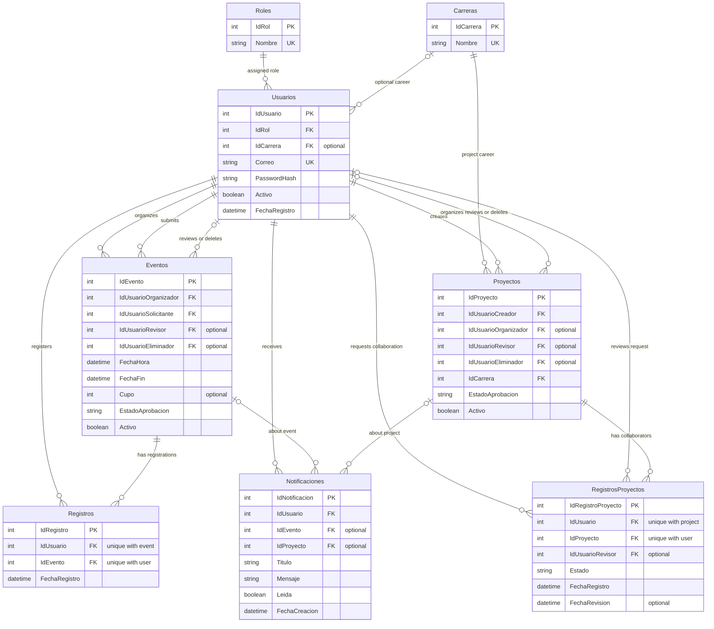

# Data Architecture & Persistence Layer

The application persists eight relational entities in SQL Server through Entity Framework Core. EF Core migrations own schema changes, while an in-process memory cache is used for the career catalog.

## Database Configuration

| Service/Module | DB Type | Profile | Driver | Connection | Migration Tool |
|---|---|---|---|---|---|
| Gestión de eventos | SQL Server | Same provider in all environments; connection configuration is environment-specific | Microsoft.EntityFrameworkCore.SqlServer | ASP.NET Core configuration; credentials are expected from the environment or a secret store | EF Core migrations |

`GestionEventosDbContext` uses pooled contexts. On startup, migrations create or upgrade the database; a recognized legacy schema is adopted at the initial migration baseline before the modernization migration is applied. Role and career example data is seeded idempotently by application startup. `documentacion/GestionEventos.sql` is an optional seed-only script.

## Data Ownership per Service

| Service | Tables Owned | ORM Framework | Caching | Notes |
|---|---|---|---|---|
| GestionEventos web application | `ROLES`, `CARRERAS`, `USUARIOS`, `EVENTOS`, `PROYECTOS`, `REGISTROS`, `REGISTROS_PROYECTOS`, `NOTIFICACIONES` | EF Core | ASP.NET Core `IMemoryCache` | One application and one logical database own all entities; there are no separate services or schemas. |

## Entity Model

Entity definitions are in `Models/Rol.cs`, `Models/Carrera.cs`, `Models/Usuario.cs`, `Models/Evento.cs`, `Models/Proyecto.cs`, `Models/Registro.cs`, `Models/RegistroProyecto.cs`, and `Models/Notificacion.cs`. Relationships are configured centrally in `Data/GestionEventosDbContext.cs`.

<!-- mermaid-checked: every attribute is `<type> <name> [<key>] ["<description>"]` with at most one of PK/FK/UK, no \n in descriptions, no {} in descriptions, every relationship label is double-quoted -->

EF Core navigation properties are bidirectional for users, careers, events, projects, and participation records; notification links to an event or project are unidirectional from the publication model. Foreign keys from other entities to users use `NO ACTION`, preventing physical user deletion from cascading through audit history. Registration uniqueness and publication/notification checks are configured in the model and migrations.

## Key Repository Methods

The application does not define repository interfaces or repository classes. Controllers query `GestionEventosDbContext` directly using EF Core LINQ.

| Service | Repository | Notable Methods | Purpose |
|---|---|---|---|
| GestionEventos | `GestionEventosDbContext` in `Data/GestionEventosDbContext.cs` | `AnyAsync`, `FirstOrDefaultAsync`, `Include` / `ThenInclude`, `CountAsync` | Scoped lookups, eager loading, and participant/capacity counts. |
| GestionEventos | `GestionEventosDbContext` | `ExecuteDeleteAsync`, `SaveChangesAsync` | Bulk removal of user-owned registrations or notifications and persistence of aggregate changes. |
| GestionEventos | `Database.BeginTransactionAsync(IsolationLevel.Serializable)` | Registration actions in `Controllers/EventosController.cs` and `Controllers/ProyectosController.cs` | Serializes event capacity checks and unique participation updates. |

## Caching Strategy

`IMemoryCache` caches the career catalog under a single in-process key with a 10-minute absolute expiration. Career administration explicitly evicts the entry after changes. There is no distributed cache, second-level ORM cache, or session data cache; each application instance has its own catalog copy.

## Data Ownership Boundaries

All tables share one SQL Server database and are owned by one application module. There is no service-to-service persistence boundary, CQRS split, or repository abstraction. Controllers perform direct EF Core reads and writes; related data is loaded through navigation properties, while registrations and notifications can be deleted in bulk through EF Core. Serializable transactions protect the event capacity check, and database unique indexes backstop duplicate registrations.

### Data Classification & Sensitivity

| Entity | Sensitive Fields | Classification (PII/PHI/PCI/None) | Controls in Place |
|---|---|---|---|
| `Usuarios` | Names, surnames, email, password hash | PII | Passwords are stored as ASP.NET Core password hashes. Role-based application access is present; no field-level encryption or masking is identified in the data layer. |
| `Notificaciones` | Recipient user ID and free-text title/message | PII may appear in message text | Notifications are scoped to authenticated users in application queries; no field-level encryption or masking is identified. |
| `Eventos`, `Proyectos`, registration entities | User identifiers, publication and participation history | PII through relationships | Access is governed by application authorization and foreign-key constraints; no field-level encryption or masking is identified. |
| All entities | No health or payment-card fields identified | No PHI or PCI detected | No application-level encryption-at-rest configuration was identified. |
